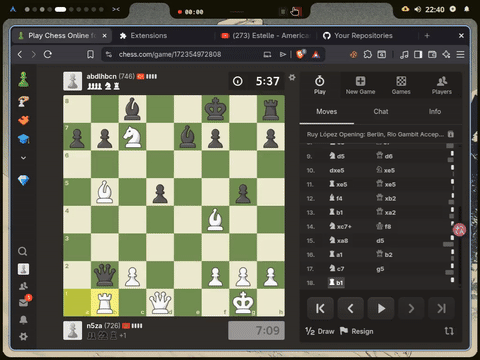

<div align="center">

# ♞ ChessMate

**See the next move. Explore positions. Choose your engine strength.**

A Chrome / Edge extension that draws move suggestions on **chess.com** and **lichess.org**, powered by Stockfish running locally on your device.

[Download ZIP](https://github.com/n5za/chess-mate/archive/refs/heads/main.zip) · [Installation](#installation) · [Report a bug](https://github.com/n5za/chess-mate/issues) · [Source code](https://github.com/n5za/chess-mate)

</div>


## Why ChessMate?

- **Move arrows on the board** — see the suggested move without switching to another app.
- **Quick arrows** — a 200 ms engine search budget, with no added arrow display delay.
- **Adjustable strength** — choose an approximate engine Elo from **1320 to 3190**, or use full strength.
- **Local Stockfish 18 Lite** — the engine runs on your device; no remote engine service is needed.
- **Two supported sites** — board detection for chess.com and lichess, including analysis views, studies and puzzles.
- **Your preferred view** — evaluation badges, flipped-board support, and always-visible, Alt-key or hover arrows.

Use ChessMate for analysis and learning. The extension also includes live-board assistance and optional automatic play; these features are not permission to use engine assistance against other players. Use analysis boards or environments where assistance is explicitly allowed.

## Demo



[Watch the MP4 demo](src/img-videa/20260731_224051.mp4). These recordings show an earlier version; the v1.3 settings panel has been redesigned.

## Installation

1. **Download and extract** the [repository ZIP](https://github.com/n5za/chess-mate/archive/refs/heads/main.zip), or clone it:

   ```bash
   git clone https://github.com/n5za/chess-mate.git
   ```

2. Open `chrome://extensions` in Chrome or `edge://extensions` in Edge, then enable **Developer mode**.
3. Click **Load unpacked** and select the extracted `chess-mate-main` folder, or the cloned `chess-mate` folder. Choose the folder containing `manifest.json`.

No build step is required. Pin ChessMate from your browser's extensions menu to access its settings.

## Show your first move suggestion

1. Open an analysis board on chess.com or lichess.org.
2. Open ChessMate and turn on the master switch.
3. Set **Mode → Analysis only** and **Show arrows → Always**.
4. Leave **Quick arrows · 200 ms search** enabled and **Auto-play** disabled.
5. Set up a position or move a piece. The arrow shows the engine's suggested move.

Want softer suggestions? Select **Playing strength → Target Elo**, then adjust the slider. Settings save automatically.

## Quick arrows and target Elo

**Quick arrows** is enabled by default. It limits the engine search to 200 ms, checks board mutations after a short 16 ms delay, and displays the arrow as soon as the result arrives. It does **not** speed up automatic move execution or mouse movement.

The search budget is not an end-to-end response-time guarantee. Engine startup, your hardware, board animations and rendering can add latency. Disable Quick arrows to use longer search times and the optional arrow display delay.

**Target Elo** uses Stockfish's native strength limiting and its final selected move, including weaker choices. The supported range is 1320–3190. This is an approximate engine rating, **not a calibrated chess.com or lichess rating**, and it does not guarantee human-like play. Short searches can reduce accuracy and rating consistency.

## Settings at a glance

| Setting | Default | What it controls |
| --- | --- | --- |
| Master switch | On | Enable or disable suggestions |
| Mode | Live + Analysis | Which board views receive suggestions |
| Playing strength | Full engine strength | Full strength or target Elo |
| Target Elo | 1600 | Used when Target Elo is selected |
| Quick arrows | On | 200 ms search budget and immediate arrow display |
| Depth | 22 | Search depth limit; popup range 8–30 |
| Analysis / live time | 3 seconds each | Search time limits when Quick arrows is off |
| Show arrows | Always | Always, while holding Alt, or while hovering over the board |
| Think delay | 0–0 seconds | Live arrow display delay when Quick arrows is off |
| Only your turn | On | Hide live suggestions on the opponent's turn |
| Show evaluation | On | Display the score beside the arrow |
| Auto-play | Off | Optional automatic move execution |
| Auto next game | Off | Optional automatic game queueing |

The popup also includes automatic-play speed, thinking delays, optional idle mouse movement and second-choice move probability. The second-choice setting is disabled in Target Elo mode so it cannot override the engine's selected move.

**Shortcut:** `Alt+Shift+S` toggles suggestions in the active supported tab.

## Updating and troubleshooting

**Update an existing installation:** run `git pull` in your clone, or download and extract the latest ZIP into your installation folder. Open your browser's extensions page, click **Reload** on ChessMate, then refresh the chess page.

**No arrow appears?**

- Check the master switch, Mode and Show arrows settings.
- For a simple check, use an analysis board with **Analysis only** and **Always** selected.
- Keep the tab visible. Analysis pauses in hidden tabs.
- Reload the extension and refresh the page after updating.
- If the problem persists, [open an issue](https://github.com/n5za/chess-mate/issues) with your browser version, site, board view, settings and reproduction steps. Include a screenshot if useful, but remove personal information.

Site layout changes can affect board detection. Automated tests cover simulated boards; they do not guarantee compatibility with every live site layout.

## What's new in v1.3

- Native target Elo selection and a redesigned settings panel.
- Quick arrows with a 200 ms search budget and immediate result display.
- Correct use of Stockfish's final `bestmove`, rather than always choosing its strongest analysis line.
- Isolated request IDs across tabs and fewer premature search retries.
- Fixes for engine readiness, reset/recovery and stale results after settings changes.
- Save feedback, keyboard focus styles and additional regression tests.

## Development

```text
Board → content.js → background.js → offscreen.js → Stockfish worker
          ↑                            │
          └──── move result + score ───┘
```

| File | Purpose |
| --- | --- |
| `src/content.js` | Board detection, FEN extraction, arrows and optional automatic play |
| `src/inject.js` | Lichess main-world bridge for position and player state |
| `src/background.js` | Message routing and offscreen document lifecycle |
| `src/offscreen.js` | Stockfish worker host and search management |
| `src/engine/` | Bundled Stockfish 18 Lite JavaScript and WebAssembly |
| `src/popup/` | Settings interface |
| `tests/` | Engine, routing, content and popup regression tests |

Run the tests with Node.js:

```bash
cd tests
npm ci
node test-engine.js
node test-content.js
```

The browser suite uses Puppeteer and currently expects Brave at `/opt/brave-bin/brave`. If your Chromium-based browser is elsewhere, change `executablePath` in `tests/test-content.js`. The engine/routing suite uses mocks and does not require a browser.

## Credits and contributions

Powered by [Stockfish](https://github.com/official-stockfish/Stockfish), using the [Stockfish.js](https://github.com/nmrugg/stockfish.js) build. The bundled engine identifies itself as GPLv3; its upstream licensing applies. This repository does not currently include a separate license for the extension code.

Bug reports and focused pull requests are welcome. For board-detection issues, include the site and a reproducible position or sequence of steps.

**Found ChessMate useful? [Give the repository a star](https://github.com/n5za/chess-mate) ⭐ — and share what you would like improved.**
